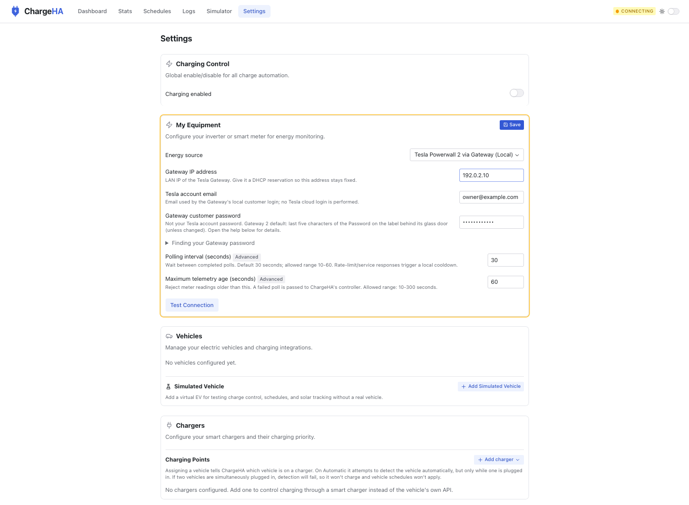

# PR86 final review evidence

Prepared candidate `d93e817e531bcb8892f3740a1e4805a85d48b0b4`. Development checks, not new hardware validation or independent human expert certification.

| Request | Disposition |
|---|---|
| Smaller poller | One cancellable loop; serialized drain/restart; stopped guard; ordinary success/failure cadence. |
| Remove shared retries and adapter duplication | Removed; request timeouts, cooldown and freshness remain. |
| Preserve explanatory comments / reuse helper | Retained behavioural comments and extended MockEnergyPollerAdapter. |
| Plugin conventions | Connection test on plugin; safe persistent logging; null cookie; typed values; shared defaults/schema; options-object errors; SOC constants/source. |
| Naming / compatibility | Tesla Powerwall 2 via Gateway (Local); powerwall2_local / powerwall2-local unchanged. Gateway2 tested, Gateway1 unverified, PW3 unsupported. |
| Migration note | Removed from the permanent guide. |
| Other misplaced narrative | Historical field-testing notes removed from permanent guide; operational guidance retained. |
| README | Only the Powerwall row added; setup link and Gateway requirements in Details. |
| Full Settings | Updated desktop/full-page/narrow captures using real built UI with synthetic transport. |
| Galleries | Partial: Powerwall, OCPP and GoodWe. Remaining plugins need pure-view extraction. |
| Battery history | Separate follow-up, not included. |

## Checks

Full check:all passes: **216 server suites / 2,988 steps; 124 client files / 1,602 tests**, plus format/lint/types/repository gates. Production build passes. Prior independent lifecycle/error findings were repaired and accepted on the parent; this final cleanup changes documentation/display strings and removes the pre-release-only fixture from the repository.

Settings edit/Save clears dirty state and retains the synthetic value; password stays masked. Zero browser page errors. Browser-reported narrow layout width487px, not a physical-phone test. CONNECTING is expected because the fixture has no SSE backend. No Gateway requests or production data.

**Not deployed or newly hardware-validated.** Historical field observations belong to the prior live build. Gateway1, other firmware and other energy hardware remain unverified. Gallery coverage is partial; battery history stays separate.

## Synthetic Settings screenshots

[Entire Settings page](settings-full-page-synthetic.jpg) · [Narrow layout](settings-narrow-synthetic.png)
