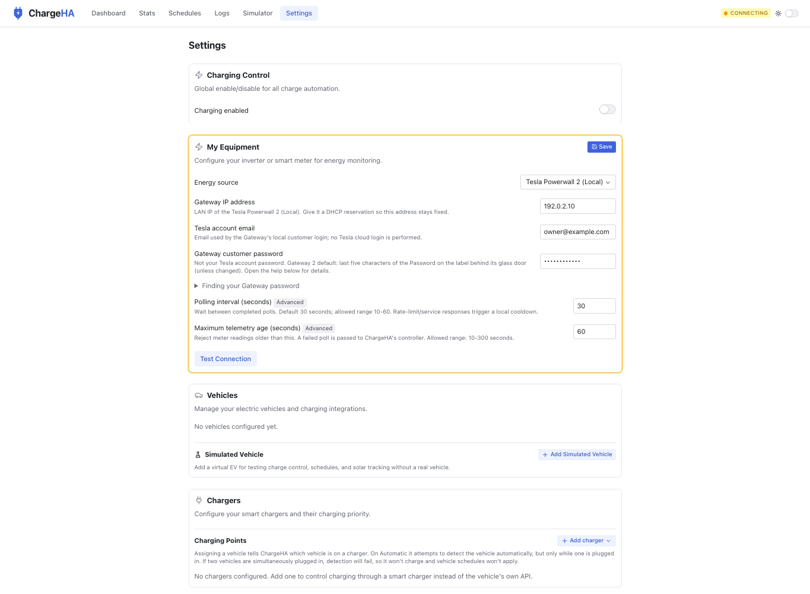

# PR86 feedback evaluation — 19 October 2026

Evaluated revision: [0a20457](https://github.com/ramforge-ai/ChargeHA/commit/0a20457f423290debd4df0e77eb1bbc60bb33d30). These are development checks, not new hardware validation or independent human expert review.

| Request | Outcome |
|---|---|
| Small single-loop polling design | One AbortController per loop; serialized drain/reconfigure/readiness; cancellation checks before publication; stopped guard retained. |
| Remove shared retry policy | Shared helper, core retry hints and interval-floor suite removed. Ordinary configured delay after success/failure. |
| Retain explanatory comments | Wait-for-poll, snapshot reset and failure behaviour documented. |
| Reuse existing test helper | MockEnergyPollerAdapter extended; GuardedPollerHarness, double casts and arbitrary flush loop removed. |
| Plugin naming | powerwall2_local / Tesla Powerwall 2 (Local) / powerwall2-local; README, wizard and setup state Gateway 2 tested, Gateway 1 untested, PW3 unsupported. |
| Connection testing | On plugin class, one adapter factory using deps.log; construction/cleanup failures return safe results. |
| Plugin Logs | Persisted connect/direct failures; scheduled core failures retained. Safe error boundary and throttle tested. Two labelled startup phases may produce two rows, not a global one-row guarantee. |
| Cookie absence | null, not empty-string sentinel. |
| HTTP test double casts | Removed. |
| Defaults/validation | Shared named defaults and common per-setting schemas. |
| Adapter simplification | In-flight dedup and 20-second cycle timer removed; sequential reads, 10-second request deadline, cooldown and freshness retained. |
| README diff | One added row against upstream; setup link in Details. |
| Small items | One config import; named SOC constants/source link; redundant optional access removed; options-object connection errors; explicit typed values. |
| Full Settings screenshot | Actual application navigation/Settings/host Save rendered with synthetic transport; desktop/full-scroll/narrow captures below. |
| Other plugin galleries | **Partial:** OCPP and GoodWe added alongside Powerwall. Remaining plugins need pure-view extraction; inventory below. |
| Battery history | Separate future PR, no history changes here. |

## Verification

Full check:all: **217 server suites / 2,990 steps; 124 client files / 1,602 tests**, zero failures, plus formatting/lint/types/repository gates. Deno 2.9.4; isolated offline container.

Separate AI review found cancellation and error-boundary gaps; repaired before publication. Final parent rerun: **118 supplied focused steps plus five independent contract/transport tests passed**. Initial rejected-candidate probes were retained. Two historical assertions were explicitly superseded: phase-labelled connect/poll entries are allowed, and factory errors must return safe text rather than raw internals. Neither is represented as an unchanged passing assertion.

Full Settings interactions checked: editing reveals Save, Save clears dirty state, synthetic connection error is visible, password remains masked; zero browser page errors. Screenshots are not a live-device connection or physical-phone test. The browser header reads CONNECTING because this synthetic transport has no live SSE. Server persistence/migration tests are separate.

## Upgrade and limits

The ID rename requires the documented offline migration for pre-review powerwall_gateway installations. Encrypted fixture tests verify values/secrets/selection/wizard preservation, idempotency and collision rollback. This is **not automatic**, and has not been applied to the existing live installation.

Explicit stop is terminal for a poller instance; cancellation/readiness/reconfiguration races are covered. A non-cooperative request can still delay draining. Whole Powerwall cycles can exceed20seconds through several individually bounded requests. No new physical tests of other energy adapters; historical Powerwall evidence applies to the earlier build.

Gallery follow-up inventory: Fronius local/cloud, Sigenergy, Enphase, simulated energy, Tapo, simulated charger, Tesla vehicle/charger and simulated vehicle/charger. These currently combine presentation with runtime hooks and need deliberate pure-view extraction rather than mounting live wrappers in the gallery.

## Settings captures — synthetic data

[Entire scrollable Settings page](settings-full-page-synthetic.jpg) · [Narrow layout](settings-narrow-synthetic.png)
