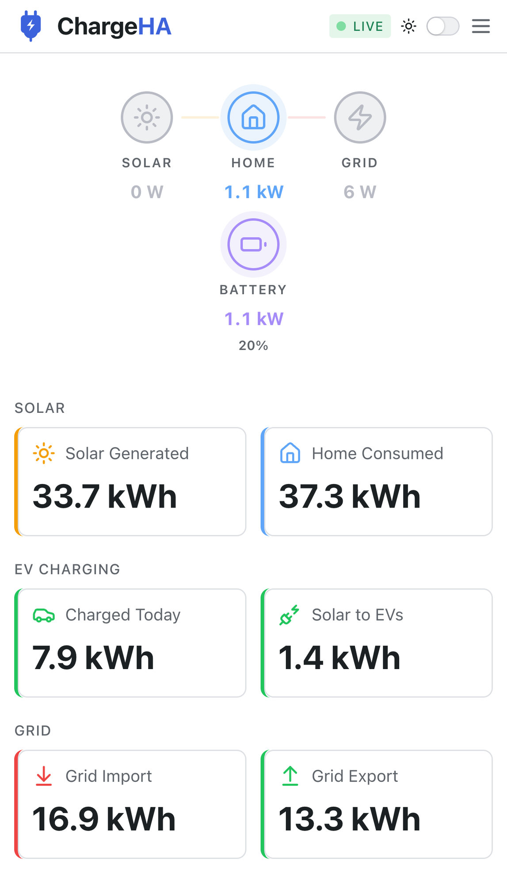
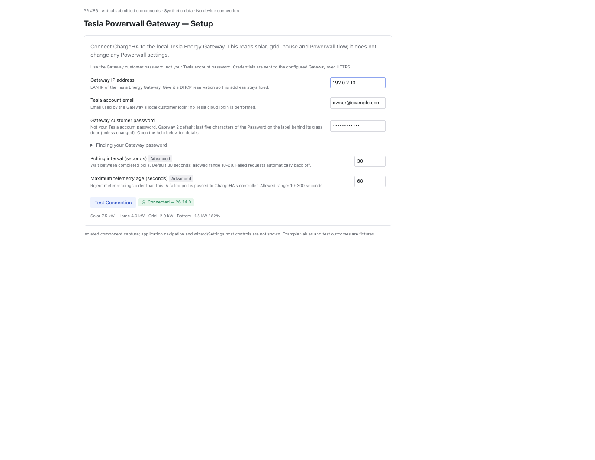
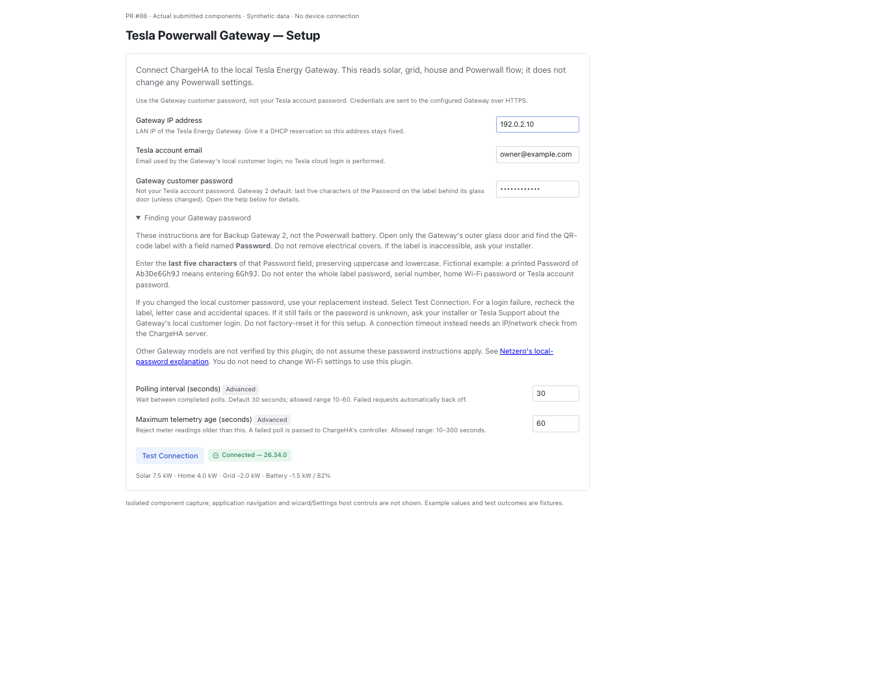
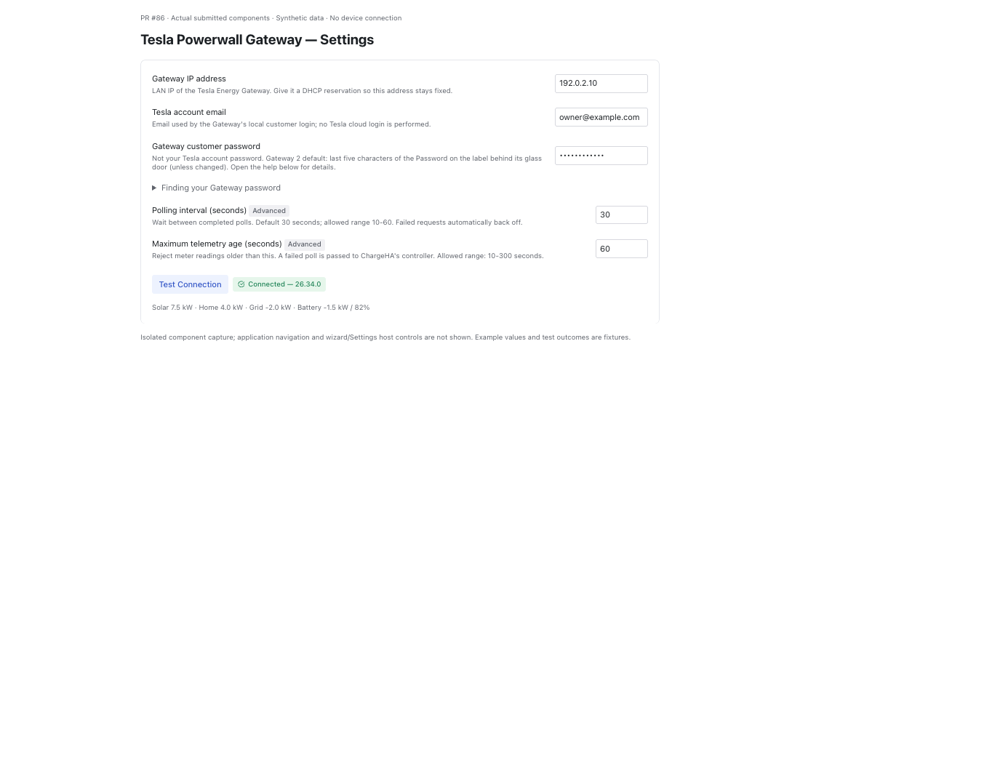
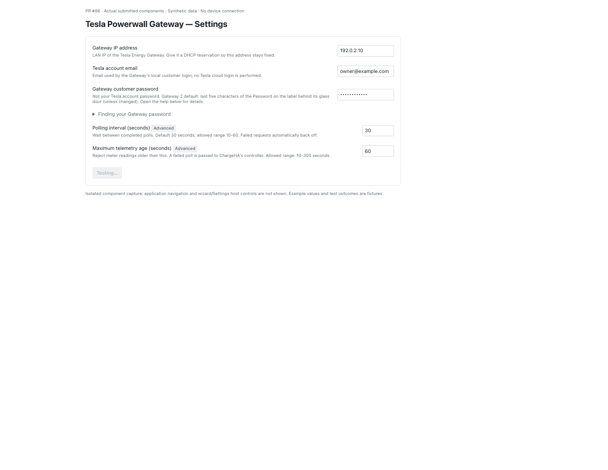
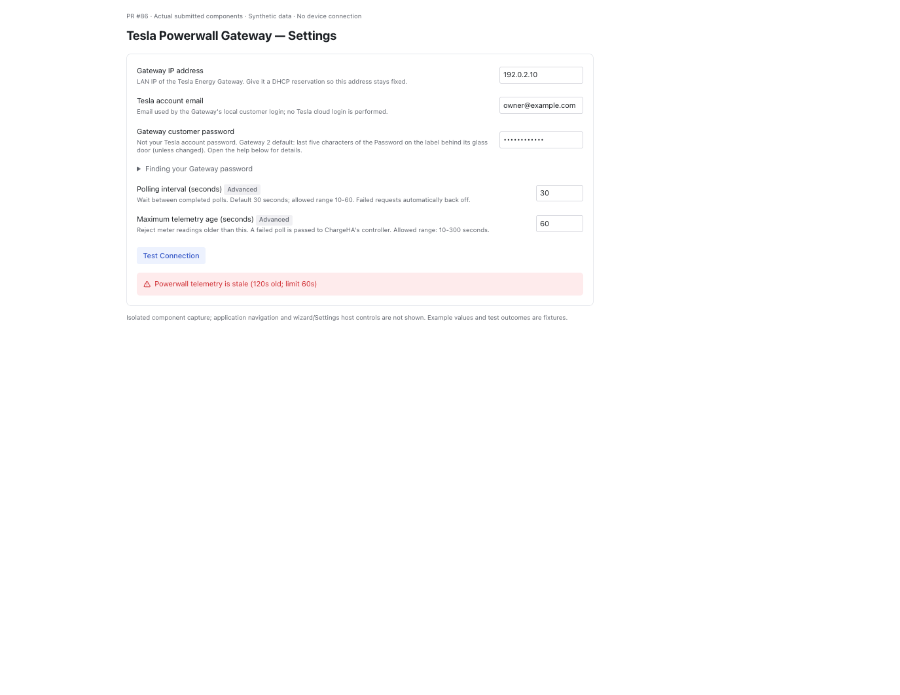
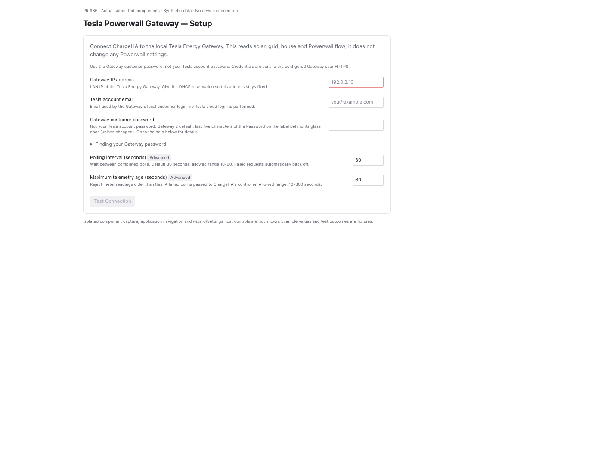
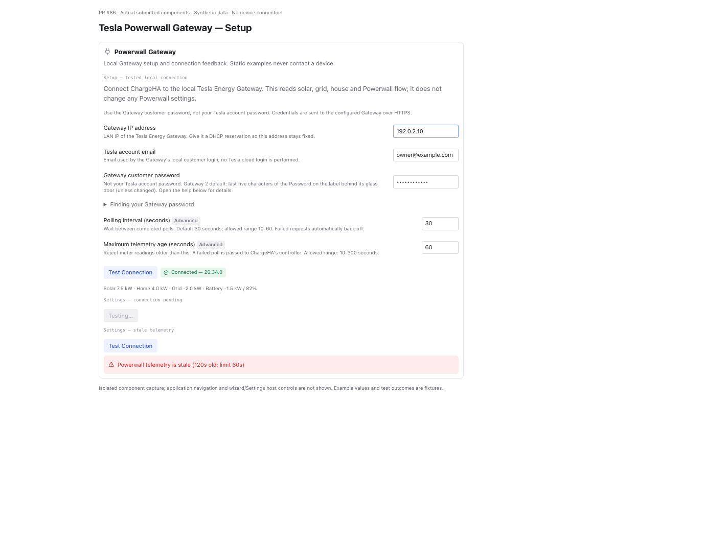

# Powerwall plugin — PR #86 review screenshots

Evidence for [ChargeHA PR #86](https://github.com/startswithaj/ChargeHA/pull/86), 18 October 2026.
This evidence branch is separate from the submitted code branch.

## Live Powerwall dashboard

Phone-sized browser capture after deploying the fixes in `6813b9c`, with existing local runtime safeguards retained outside the PR. Real telemetry, 20% battery. iPhone 13 Pro Max browser emulation at 428 × 746 CSS pixels, not a physical-phone screenshot. Private details are outside the frame; no DOM substitution or image editing.

## Synthetic UI examples

Actual plugin UI components captured at `836805d`; these presentation components are unchanged at `6813b9c`. All values, credentials and outcomes in these seven examples are fictional fixtures. No device connection is made. Host navigation and Next/Save controls are outside these component captures. These screenshots illustrate the UI, not hardware testing.

### Setup

### Password help

### Settings

### Testing

### Stale-data error

### Empty form

### Component gallery

